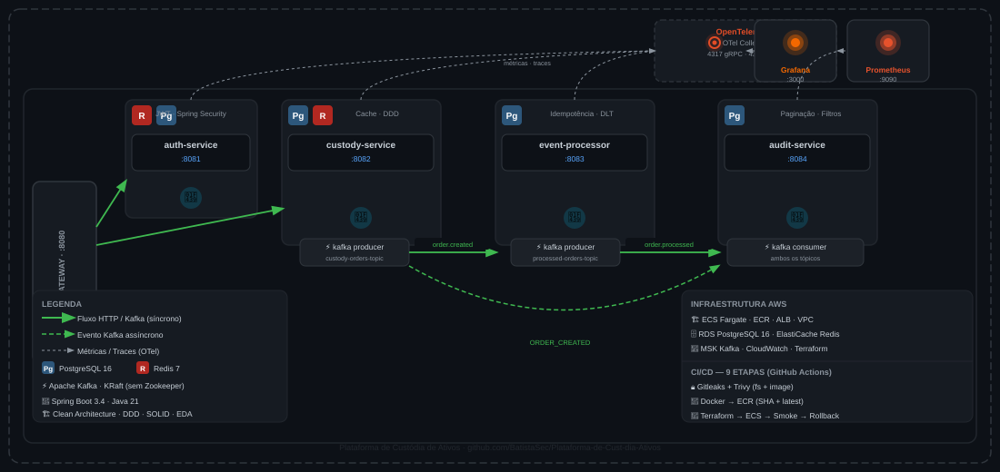

# Plataforma de Custódia de Ativos

Plataforma de custódia de ativos construída com **Java 21, Spring Boot 3.4, Clean Architecture e Arquitetura Orientada a Eventos (EDA)**.

---

## 🚀 Stack

| Camada | Tecnologias |
|---|---|
| **Backend** | Java 21, Spring Boot 3.4, Spring Security, Spring Data JPA |
| **Mensageria** | Apache Kafka (MSK na AWS) |
| **Banco de dados** | PostgreSQL 16 (RDS na AWS) |
| **Cache** | Redis 7 (ElastiCache na AWS) |
| **Arquitetura** | Clean Architecture, DDD, SOLID, Event-Driven (EDA) |
| **Observabilidade** | Actuator, Prometheus, Grafana, OpenTelemetry, AWS CloudWatch |
| **Infraestrutura** | Docker, Terraform, AWS ECS Fargate, ECR, ALB, VPC |
| **CI/CD** | GitHub Actions — pipeline de 9 etapas com rollback automático |
| **Spec-Driven Dev** | OpenSpec 1.15.0 — proposal + specs + design + tasks por feature |

---

## 🏗️ Arquitetura de Microsserviços



---

## 📦 Microsserviços

### 🚪 API Gateway — porta `8080`
Ponto único de entrada. Valida JWT localmente via `JwtUtil` e roteia para os serviços internos via Spring Cloud Gateway. Endpoints `/api/v1/auth/**` são públicos; todos os demais exigem token.

### 🛡️ Auth Service — porta `8081`
Autenticação e registro de usuários. Gera tokens JWT com o `userId` como claim.

```json
{ "token": "eyJhbGci...", "userId": "uuid-do-usuario" }
```

### 💼 Custody Service — porta `8082`
Core do negócio. Gerencia portfólios, ativos e ordens. Usa Redis para cache e publica `OrderEvent` no Kafka ao criar uma ordem.

### ⚙️ Event Processor — porta `8083`
Worker assíncrono. Consome `custody-orders-topic`, aplica idempotência (constraint única por `orderId`), processa a ordem, persiste e publica `ProcessedOrderEvent`. Retry automático com DLT.

### 🔍 Audit Service — porta `8084`
Auditoria de negócio. Consome os dois tópicos Kafka e registra **todos os eventos** na tabela `audit_logs`. Suporta consulta paginada com filtros por tipo de evento e janela temporal.

---

## 🔌 Endpoints

> Todos os endpoints exceto `/api/v1/auth/**` exigem `Authorization: Bearer <token>`.

### 🛡️ Auth Service
| Método | Endpoint | Body |
|---|---|---|
| `POST` | `/api/v1/auth/register` | `{ "email": "", "password": "" }` |
| `POST` | `/api/v1/auth/login` | `{ "email": "", "password": "" }` |

### 💼 Custody Service
| Método | Endpoint | Body |
|---|---|---|
| `POST` | `/api/v1/custody/portfolios` | `{ "userId": "uuid" }` |
| `POST` | `/api/v1/custody/portfolios/user` | `{ "userId": "uuid" }` |
| `POST` | `/api/v1/custody/assets` | `{ "ticker": "PETR4", "name": "Petrobras" }` |
| `GET`  | `/api/v1/custody/assets` | — |
| `POST` | `/api/v1/custody/orders` | `{ "portfolioId": "uuid", "assetId": "uuid", "type": "BUY", "quantity": 10.5 }` |

### ⚙️ Event Processor
| Método | Endpoint | Body |
|---|---|---|
| `GET`  | `/api/v1/processed-orders/{orderId}` | — |
| `POST` | `/api/v1/processed-orders/reprocess` | `{ "orderId": "uuid" }` |

### 🔍 Audit Service
| Método | Endpoint | Query params |
|---|---|---|
| `GET` | `/api/v1/audit/order/{orderId}` | `page`, `size`, `eventType`, `from`, `to` |
| `GET` | `/api/v1/audit/portfolio/{portfolioId}` | `page`, `size`, `eventType`, `from`, `to` |

**Parâmetros de paginação e filtro:**

| Parâmetro | Default | Descrição |
|---|---|---|
| `page` | `0` | Número da página (zero-indexed) |
| `size` | `20` | Itens por página — máx. `100` |
| `eventType` | — | `ORDER_CREATED`, `ORDER_PROCESSED` ou `ORDER_FAILED` |
| `from` | — | Início da janela temporal — formato `yyyy-MM-ddTHH:mm:ss` |
| `to` | — | Fim da janela temporal — formato `yyyy-MM-ddTHH:mm:ss` |

**Exemplo de resposta paginada:**
```json
{
  "content": [{ "id": "uuid", "eventType": "ORDER_CREATED", "occurredAt": "2026-10-15T14:30:00", "..." }],
  "page": 0, "size": 20, "totalElements": 150, "totalPages": 8,
  "first": true, "last": false
}
```

---

## 🛠️ Como rodar localmente

### 1. Subir infraestrutura base
```bash
docker-compose up -d
```
Sobe PostgreSQL (`15432`), Redis (`6379`) e Kafka (`9092`).

### 2. Subir observabilidade (opcional)
```bash
docker-compose -f docker-compose.observability.yml up -d
```
Sobe Prometheus (`9090`), Grafana (`3000` — admin/admin) e OpenTelemetry Collector (`4318`).

### 3. Iniciar os serviços
```bash
cd auth-service      && ./mvnw spring-boot:run
cd custody-service   && ./mvnw spring-boot:run
cd event-processor   && ./mvnw spring-boot:run
cd audit-service     && ./mvnw spring-boot:run
cd api-gateway       && ./mvnw spring-boot:run
```

### 4. Testar com Insomnia
Importe `insomnia-collection.json`. Fluxo sugerido:

1. **Register** → captura `token` e `userId`
2. Preenche as variáveis no environment do Insomnia
3. **Criar ativo** → captura `assetId`
4. **Criar portfólio** → captura `portfolioId`
5. **Criar ordem** → captura `orderId`
6. **Consultar auditoria** → `GET /api/v1/audit/order/{orderId}`

---

## ☁️ Deploy na AWS (Terraform)

A infraestrutura completa está em `terraform/` e provisiona VPC, RDS PostgreSQL 16, MSK Kafka, ElastiCache Redis, ECR (1 repositório por serviço), ECS Fargate (5 serviços) e ALB.

```bash
cd terraform
make bootstrap   # cria bucket S3 + DynamoDB para estado remoto (uma vez)
make init
make plan
make apply
```

---

## 🔄 CI/CD (GitHub Actions)

Pipeline de **9 etapas** por microsserviço, ativado por push em `main` ou PR:

| Etapa | Push `main` | PR |
|---|---|---|
| 1 — Validate Branch (título do PR) | ✅ | ✅ |
| 2 — Build + Testes | ✅ | ✅ |
| 3 — Security: Gitleaks + Trivy (filesystem) | ✅ | ✅ |
| 4 — Docker Build + Trivy (imagem) | ✅ | ❌ |
| 5 — Push ECR (SHA + latest) | ✅ | ❌ |
| 6 — Terraform Plan & Apply | ✅ | ❌ |
| 7 — Deploy ECS Fargate | ✅ | ❌ |
| 8 — Smoke Tests + health check | ✅ | ❌ |
| 9 — Rollback automático (se smoke falhar) | ✅ | ❌ |

Workflows: `.github/workflows/ci-cd-<serviço>.yml`  
Secrets necessários: `.github/SECRETS.md`

---

## 📐 Spec-Driven Development (OpenSpec)

O projeto usa **OpenSpec 1.15.0** para documentar e implementar funcionalidades de forma estruturada. Toda feature passa por: proposta → specs (critérios de aceitação em Gherkin) → design técnico → lista de tarefas — antes de qualquer código ser escrito.

```
openspec/
├── config.yaml                    ← regras do projeto para a IA
├── specs/                         ← specs consolidadas por capacidade
└── changes/                       ← features em andamento ou arquivadas
    └── consulta-paginada-eventos-auditoria/   ← em andamento
        ├── proposal.md
        ├── specs/audit/consulta-paginada/spec.md
        ├── design.md
        └── tasks.md
```

**Comandos disponíveis no Kiro:**

| Comando | O que faz |
|---|---|
| `/opsx-explore` | Parceiro de pensamento antes de propor |
| `/opsx-propose "descrição"` | Cria proposal + specs + design + tasks |
| `/opsx-apply` | Implementa as tarefas do tasks.md |
| `/opsx-update` | Revisa os artefatos da change ativa |
| `/opsx-archive` | Arquiva a change após implementação |

---

## 📊 Observabilidade

| Ferramenta | URL local | Finalidade |
|---|---|---|
| **Actuator** | `/actuator/health` (cada serviço) | Health check |
| **Prometheus** | `http://localhost:9090` | Coleta de métricas |
| **Grafana** | `http://localhost:3000` (admin/admin) | Dashboards |
| **OTel Collector** | `http://localhost:4318` | Traces distribuídos |
| **CloudWatch** | AWS Console | Logs e métricas em produção |

No Grafana, importe o dashboard **Spring Boot Statistics** (ID `6756`).

---

## 📁 Estrutura do Repositório

```
projeto-portifolio/
├── api-gateway/                    ← Spring Cloud Gateway + filtro JWT
├── auth-service/                   ← Autenticação + JWT
├── custody-service/                ← Core de negócio
├── event-processor/                ← Worker Kafka assíncrono
├── audit-service/                  ← Auditoria de negócio
├── terraform/                      ← Infraestrutura AWS como código
│   ├── modules/                    ← VPC, RDS, MSK, ECS, ECR, ALB...
│   └── infrastructure.tf
├── observability/                  ← Configs Prometheus, Grafana, OTel
├── openspec/                       ← Spec-Driven Development
│   ├── config.yaml
│   ├── specs/
│   └── changes/
├── docs/                           ← OpenSpec e SDD por feature
├── .github/
│   ├── workflows/                  ← Pipelines CI/CD (um por serviço)
│   └── SECRETS.md                  ← Documentação de secrets necessários
├── docker-compose.yml              ← Infra local (PostgreSQL, Redis, Kafka)
├── docker-compose.observability.yml
└── insomnia-collection.json        ← Coleção de endpoints para testes
```

---

## 🎯 Fases de Desenvolvimento

- [x] Fase 1 — Infraestrutura local (Docker Compose)
- [x] Fase 2 — Auth Service (JWT, Spring Security, Clean Architecture)
- [x] Fase 3 — API Gateway (roteamento, filtro JWT)
- [x] Fase 4 — Custody Service (DDD, Redis cache, Kafka producer)
- [x] Fase 5 — Event Processor (Kafka consumer, idempotência, retry + DLT)
- [x] Fase 6 — Audit Service (auditoria via Kafka, consulta paginada)
- [x] Fase 7 — Observabilidade (Actuator, Prometheus, Grafana, OTel, CloudWatch)
- [x] Fase 8 — CI/CD (GitHub Actions — 9 etapas com rollback automático)
- [x] Fase 9 — Infraestrutura AWS (Terraform: VPC, RDS, MSK, ECS Fargate, ALB)
- [x] Fase 10 — Spec-Driven Development (OpenSpec + Kiro)
