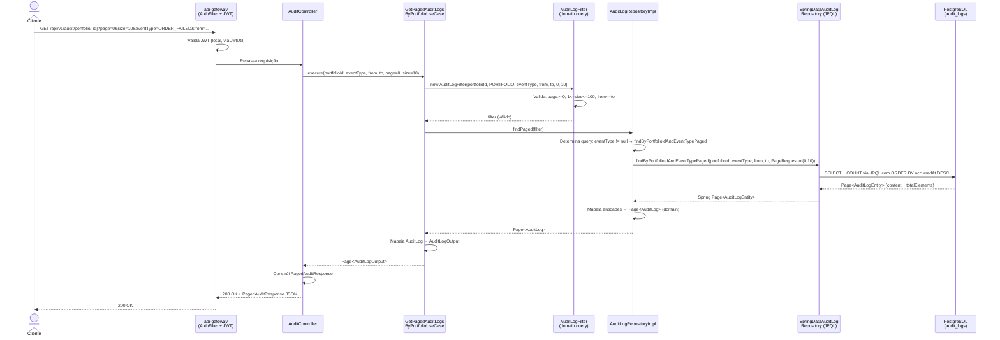
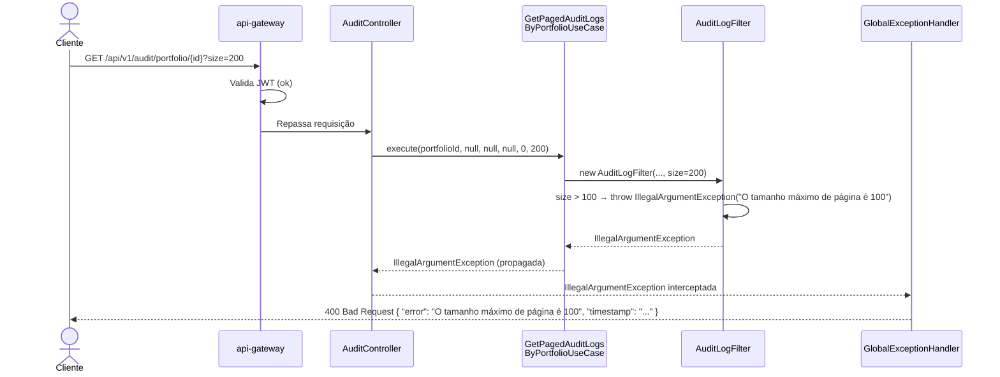
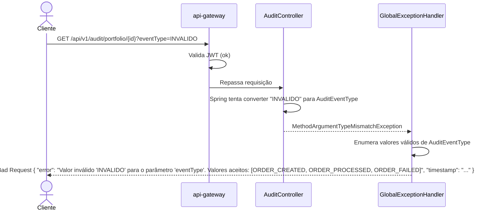
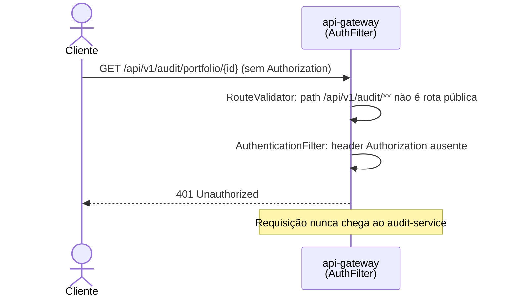
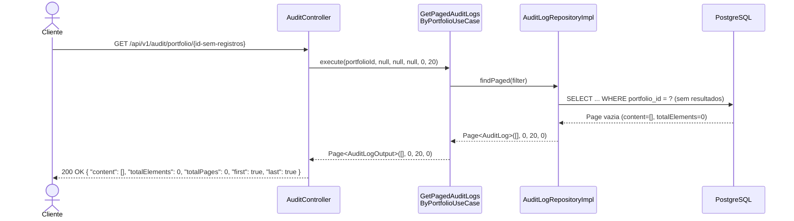

# SDD — Software Design Document
## Consulta Paginada de Histórico de Auditoria (AUDIT-001)

**Serviço:** audit-service  
**Versão:** 2.0.0  
**Status:** Em Revisão  
**Data de criação:** 2026-10-29  
**Data de revisão:** 2026-10-29  
**Revisado por:** Arquiteto de Software Sênior — auditoria completa do repositório  

---

## 1. Contexto e Requisitos

### 1.1 Problema

Os endpoints `GET /api/v1/audit/portfolio/{portfolioId}` e `GET /api/v1/audit/order/{orderId}` retornavam `List<AuditLogResponse>` (array JSON irrestrito). Em produção, um portfólio ativo pode acumular centenas de eventos por dia. Uma lista não paginada força o banco a materializar e transferir todos os registros na memória, o que não é viável em volume.

### 1.2 Escopo

**Dentro do escopo:**
- Paginação com metadados (`page`, `size`, `totalElements`, `totalPages`, `first`, `last`)
- Filtro opcional por `AuditEventType` (`ORDER_CREATED`, `ORDER_PROCESSED`, `ORDER_FAILED`)
- Filtro opcional por janela temporal (`from` / `to`, inclusivos, `LocalDateTime`)
- Validação de parâmetros com resposta 400 descritiva
- Índices compostos na tabela `audit_logs`

**Fora do escopo:**
- Ordenação dinâmica por campo arbitrário via parâmetro de query
- Exportação para CSV ou outros formatos
- Agregações ou contagens por tipo de evento
- Cache de resultados
- Isolamento de dados por usuário (o sistema não tem autorização por usuário — veja seção 8)
- Suporte a timezone explícito (registrado como P-5)

### 1.3 Requisitos funcionais

| RF | Descrição |
|---|---|
| RF-1 | A API retorna resultados paginados com metadados de paginação |
| RF-2 | O parâmetro `size` aceita valores de 1 a 100; padrão 20 |
| RF-3 | O parâmetro `page` é zero-indexed; padrão 0 |
| RF-4 | O parâmetro `eventType` filtra por tipo; ausência retorna todos os tipos |
| RF-5 | Os parâmetros `from` e `to` definem janela temporal inclusiva |
| RF-6 | A ordenação padrão é `occurredAt DESC` |
| RF-7 | Parâmetros inválidos retornam HTTP 400 com mensagem descritiva |
| RF-8 | Resultado vazio retorna HTTP 200 com `content: []` e `totalElements: 0` |

### 1.4 Requisitos não funcionais

| RNF | Descrição | Métrica |
|---|---|---|
| RNF-1 | Consultas devem usar índices compostos existentes | Plano de execução sem Seq Scan para portfólios com > 1000 registros |
| RNF-2 | Não há cache — dados são sempre lidos diretamente do PostgreSQL | — |
| RNF-3 | O limite máximo de página (100) é validado no servidor | — |
| RNF-4 | A autenticação JWT é exigida pelo api-gateway antes do audit-service | — |

> **Meta de latência:** o SDD v1.0.0 propunha p99 < 200ms. Esta é uma **recomendação a validar**, não um requisito contratual acordado. Registrada como pendência RNF-M-1.

### 1.5 Premissas

- O banco de dados é PostgreSQL 16, com `ddl-auto: update` (sem Flyway/Liquibase no projeto atual).
- Os índices são criados/atualizados pelo Hibernate via DDL automático.
- A autenticação é responsabilidade do api-gateway; o audit-service não valida JWT diretamente.
- Não há regras de autorização por usuário no domínio atual (qualquer token válido acessa qualquer portfólio/ordem).

### 1.6 Dependências

| Componente | Papel |
|---|---|
| `api-gateway` | Valida JWT antes de rotear para o audit-service |
| `custody-service` | Produce `OrderEvent` → `custody-orders-topic` |
| `event-processor` | Produce `ProcessedOrderEvent` → `processed-orders-topic` |
| PostgreSQL 16 | Armazena a tabela `audit_logs` |
| `AuditLogMapper` | Conversão entre `AuditLogEntity` (JPA) e `AuditLog` (domínio) |

---

## 2. Arquitetura e Fluxo de Execução

### 2.1 Diagrama de sequência — Requisição válida com filtros



---

### 2.2 Diagrama de sequência — Parâmetros inválidos (size > 100)



---

### 2.3 Diagrama de sequência — eventType inválido



---

### 2.4 Diagrama de sequência — Usuário não autenticado



---

### 2.5 Diagrama de sequência — Resultado vazio



---

## 3. Arquivos Afetados

### 3.1 Estado atual (após primeiro ciclo de implementação)

| Caminho | Ação | Status | Responsabilidade | Observação |
|---|---|---|---|---|
| `domain/models/Page.java` | CRIADO | ✅ Compilando | Record de paginação sem Spring Data | `isLast()` trata `totalPages=0` corretamente |
| `domain/enums/FilterSubject.java` | CRIADO | ✅ Compilando | Discrimina ORDER vs PORTFOLIO | — |
| `domain/query/AuditLogFilter.java` | CRIADO | ✅ Compilando | Critério de busca com validações no domínio | Movido de `application/dto` após revisão |
| `domain/repositories/AuditLogRepository.java` | MODIFICADO | ✅ Compilando | Adicionado `findPaged(AuditLogFilter)` | Importa `AuditLogFilter` de `domain.query` — correto |
| `application/usecases/GetPagedAuditLogsByPortfolioUseCase.java` | CRIADO | ✅ Compilando | Use case paginado por portfólio | — |
| `application/usecases/GetPagedAuditLogsByOrderUseCase.java` | CRIADO | ✅ Compilando | Use case paginado por ordem | — |
| `application/usecases/GetAuditLogsByOrderUseCase.java` | MANTIDO | ✅ Sem alteração | Use case legado (sem consumidor no controller) | Candidato a remoção em P-3 |
| `application/usecases/GetAuditLogsByPortfolioUseCase.java` | MANTIDO | ✅ Sem alteração | Use case legado (sem consumidor no controller) | Candidato a remoção em P-3 |
| `presentation/response/PagedAuditResponse.java` | CRIADO | ✅ Compilando | Envelope HTTP de paginação | — |
| `presentation/controllers/AuditController.java` | MODIFICADO | ✅ Compilando | Controller com novos query params | Use cases legados removidos do construtor |
| `presentation/controllers/GlobalExceptionHandler.java` | MODIFICADO | ✅ Compilando | Handlers para type mismatch e 500 seguro | `ex.getMessage()` não é mais exposto no 500 |
| `infrastructure/persistence/repositories/SpringDataAuditLogRepository.java` | MODIFICADO | ✅ Compilando | 4 queries JPQL especializadas | Sem uso de `null IS NULL OR` em enum |
| `infrastructure/persistence/adapters/AuditLogRepositoryImpl.java` | MODIFICADO | ✅ Compilando | Implementa `findPaged()` com 4 branches | Import explícito de `AuditLogEntity` |
| `infrastructure/persistence/entities/AuditLogEntity.java` | MODIFICADO | ✅ Compilando | Índices compostos adicionados | Veja seção 7 |

### 3.2 Arquivos pendentes (não existem ainda)

| Caminho | Ação | Justificativa |
|---|---|---|
| `src/test/java/.../domain/query/AuditLogFilterTest.java` | CRIAR | Testes unitários das validações do filtro |
| `src/test/java/.../domain/models/PageTest.java` | CRIAR | Testes dos métodos calculados (`totalPages`, `isFirst`, `isLast`) |
| `src/test/java/.../usecases/GetPagedAuditLogsByPortfolioUseCaseTest.java` | CRIAR | Testes do use case com repositório mockado |
| `src/test/java/.../usecases/GetPagedAuditLogsByOrderUseCaseTest.java` | CRIAR | Testes do use case com repositório mockado |
| `src/test/java/.../presentation/AuditControllerTest.java` | CRIAR | Testes do controller com MockMvc |
| `src/test/java/.../infrastructure/AuditLogRepositoryImplTest.java` | CRIAR | Testes de integração com banco real (Testcontainers PostgreSQL) |
| `src/test/resources/application-test.yml` | CRIAR | Config do banco de testes |

---

## 4. Design das Classes

### 4.1 `AuditLogFilter` — `domain.query`

**Responsabilidade:** encapsular os critérios de busca paginada de `AuditLog` e garantir sua validade através de invariantes no construtor.

```java
package com.custody.audit_service.domain.query;

public final class AuditLogFilter {

    // Constantes de negócio
    static final int MAX_PAGE_SIZE = 100;
    static final int MIN_PAGE_SIZE = 1;

    // Estado imutável
    private final UUID           subjectId;   // orderId ou portfolioId
    private final FilterSubject  subject;     // ORDER | PORTFOLIO
    private final AuditEventType eventType;   // nullable — sem filtro se null
    private final LocalDateTime  from;        // nullable — sem limite inferior se null
    private final LocalDateTime  to;          // nullable — sem limite superior se null
    private final int            page;        // >= 0
    private final int            size;        // 1..100

    // Invariantes verificadas no construtor
    // page >= 0                               → IllegalArgumentException
    // size em [1, 100]                        → IllegalArgumentException
    // from != null && to != null → from <= to → IllegalArgumentException
}
```

**Impacto:** nenhum. Classe final imutável sem dependência de framework.

---

### 4.2 `Page<T>` — `domain.models`

**Responsabilidade:** transportar resultado paginado entre camadas sem expor Spring Data.

```java
public record Page<T>(
    List<T> content,
    int     page,
    int     size,
    long    totalElements
) {
    // Métodos calculados
    public int     totalPages()   // ceil(totalElements / size), 0 se size=0
    public boolean isFirst()      // page == 0
    public boolean isLast()       // totalPages()==0 || page >= totalPages()-1
}
```

**Edge cases documentados:**
- `totalElements = 0` → `totalPages() = 0`, `isFirst() = true`, `isLast() = true`
- `size = 0` → guard em `AuditLogFilter` impede chegar aqui, mas `totalPages()` retorna 0 por segurança
- `page > totalPages()-1` → `isLast() = true` (page além do total ainda é "last")

---

### 4.3 `GetPagedAuditLogsByPortfolioUseCase` — `application.usecases`

**Responsabilidade:** orquestrar a consulta paginada por portfólio. Constrói o `AuditLogFilter`, delega para o repositório, mapeia o resultado.

```
execute(portfolioId, eventType, from, to, page, size) → Page<AuditLogOutput>
```

Lança `IllegalArgumentException` (via `AuditLogFilter`) se os parâmetros forem inválidos — propagada até o `GlobalExceptionHandler` → HTTP 400.

Não faz mapeamento de exceções de persistência; erros de banco propagam-se até o handler genérico → HTTP 500.

---

### 4.4 `GetPagedAuditLogsByOrderUseCase` — `application.usecases`

Idêntico ao anterior, com `FilterSubject.ORDER` em vez de `FilterSubject.PORTFOLIO`. Sem lógica adicional.

---

### 4.5 `AuditController` — `presentation.controllers`

**Responsabilidade:** receber os parâmetros HTTP, delegar para os use cases e construir o `PagedAuditResponse`.

```
@GetMapping("/portfolio/{portfolioId}")
ResponseEntity<PagedAuditResponse> getByPortfolio(
    @PathVariable UUID portfolioId,
    @RequestParam(required=false) AuditEventType eventType,
    @RequestParam(required=false) @DateTimeFormat(iso=ISO.DATE_TIME) LocalDateTime from,
    @RequestParam(required=false) @DateTimeFormat(iso=ISO.DATE_TIME) LocalDateTime to,
    @RequestParam(defaultValue="0")  int page,
    @RequestParam(defaultValue="20") int size
)

@GetMapping("/order/{orderId}")
ResponseEntity<PagedAuditResponse> getByOrder(...mesmo esquema...)
```

O controller **não valida parâmetros diretamente** — a validação é feita no construtor de `AuditLogFilter`. O `GlobalExceptionHandler` intercepta a `IllegalArgumentException` e retorna 400.

**Breaking change:** retorna `PagedAuditResponse` (objeto) em vez de `List<AuditLogResponse>` (array). Clientes anteriores precisam ser migrados.

---

### 4.6 `AuditLogRepositoryImpl` — `infrastructure.persistence.adapters`

**Responsabilidade:** implementar `AuditLogRepository.findPaged()` usando Spring Data JPA, convertendo o `Page` do Spring para o `Page` do domínio.

Estratégia de seleção de query (decisão de design para evitar o bug de enum nullable no Hibernate 6):

```
se subject == PORTFOLIO:
    se eventType != null → findByPortfolioIdAndEventTypePaged(...)
    se eventType == null → findByPortfolioIdPaged(...)
senão (ORDER):
    se eventType != null → findByOrderIdAndEventTypePaged(...)
    se eventType == null → findByOrderIdPaged(...)
```

---

### 4.7 `SpringDataAuditLogRepository` — `infrastructure.persistence.repositories`

4 queries JPQL dedicadas. A separação com/sem `eventType` é intencional para evitar o problema de inferência de tipo do Hibernate com parâmetros enum nullable.

**Ordenação atual:**
```jpql
ORDER BY e.occurredAt DESC
```

**Pendência P-1:** adicionar `e.id ASC` como desempate:
```jpql
ORDER BY e.occurredAt DESC, e.id ASC
```

---

### 4.8 `GlobalExceptionHandler` — `presentation.controllers`

| Handler | Exceção | HTTP | Observação |
|---|---|---|---|
| `handleIllegalArgument` | `IllegalArgumentException` | 400 | Cobre validações do `AuditLogFilter` |
| `handleTypeMismatch` | `MethodArgumentTypeMismatchException` | 400 | Enumera valores aceitos para enums |
| `handleValidation` | `MethodArgumentNotValidException` | 400 | Bean validation (não usado atualmente nesta feature) |
| `handleNotReadable` | `HttpMessageNotReadableException` | 400 | JSON malformado |
| `handleResourceNotFound` | `ResourceNotFoundException` | 404 | Não usado nesta feature, mas presente no serviço |
| `handleGeneric` | `Exception` | 500 | **Não expõe `ex.getMessage()` — corrigido** |

---

## 5. Contrato da API

### 5.1 Endpoints

```
GET /api/v1/audit/portfolio/{portfolioId}
GET /api/v1/audit/order/{orderId}
```

Ambos requerem `Authorization: Bearer <token-jwt-válido>` (validado pelo api-gateway).

### 5.2 Parâmetros de query

| Parâmetro | Tipo Java | Formato aceito | Default | Validação |
|---|---|---|---|---|
| `page` | `int` | inteiro >= 0 | `0` | Falha com 400 se negativo |
| `size` | `int` | inteiro 1–100 | `20` | Falha com 400 se fora do intervalo |
| `eventType` | `AuditEventType` | `ORDER_CREATED`, `ORDER_PROCESSED`, `ORDER_FAILED` | ausente | Falha com 400 se valor inválido (Spring faz a conversão) |
| `from` | `LocalDateTime` | `yyyy-MM-ddTHH:mm:ss` | ausente | Falha com 400 se posterior a `to` |
| `to` | `LocalDateTime` | `yyyy-MM-ddTHH:mm:ss` | ausente | Falha com 400 se anterior a `from` |

### 5.3 Resposta de sucesso — `200 OK`

```json
{
  "content": [
    {
      "id":          "550e8400-e29b-41d4-a716-446655440000",
      "orderId":     "uuid-da-ordem",
      "portfolioId": "uuid-do-portfolio",
      "assetId":     "uuid-do-ativo-ou-null",
      "eventType":   "ORDER_CREATED",
      "payload":     "{\"orderId\":\"...\",\"portfolioId\":\"...\"}",
      "occurredAt":  "2026-10-15T14:30:00"
    }
  ],
  "page":          0,
  "size":          20,
  "totalElements": 1,
  "totalPages":    1,
  "first":         true,
  "last":          true
}
```

**Semântica dos campos de metadados:**

| Campo | Tipo | Semântica |
|---|---|---|
| `content` | array | Registros da página atual, ordenados por `occurredAt DESC` |
| `page` | int | Número da página atual (zero-indexed) |
| `size` | int | Tamanho solicitado (pode diferir do tamanho de `content` na última página) |
| `totalElements` | long | Total de registros que satisfazem os filtros aplicados |
| `totalPages` | int | `ceil(totalElements / size)`; 0 quando não há registros |
| `first` | boolean | `page == 0` |
| `last` | boolean | `page >= totalPages - 1`, ou `true` quando `totalPages == 0` |

### 5.4 Respostas de erro

```json
// 400 Bad Request
{
  "error":     "O tamanho máximo de página é 100",
  "timestamp": "2026-10-29T14:00:00.123"
}

// 400 — eventType inválido
{
  "error":     "Valor inválido 'INVALIDO' para o parâmetro 'eventType'. Valores aceitos: [ORDER_CREATED, ORDER_PROCESSED, ORDER_FAILED]",
  "timestamp": "2026-10-29T14:00:00.123"
}

// 401 Unauthorized — retornado pelo api-gateway, não pelo audit-service
// corpo vazio ou body do gateway

// 500 Internal Server Error
{
  "error":     "Erro interno do servidor",
  "timestamp": "2026-10-29T14:00:00.123"
}
```

### 5.5 Breaking change

A versão anterior dos endpoints retornava:
```json
[
  { "id": "...", "orderId": "...", ... }
]
```
A versão atual retorna o envelope `PagedAuditResponse`. Isso é uma mudança incompatível no mesmo path/versão.

---

## 6. Query JPQL e Estratégia de Persistência

### 6.1 Estratégia adotada

Quatro métodos JPQL dedicados em `SpringDataAuditLogRepository`, selecionados em tempo de execução pelo `AuditLogRepositoryImpl` com base na presença ou ausência de `eventType`. Esta abordagem foi escolhida sobre:

- **`x IS NULL OR x = :param`** — descartada: bug confirmado no Hibernate 6 com enums nullable em alguns dialetos.
- **Criteria API** — descartada: introduziria nova abstração não usada no restante do projeto.
- **Spring Data Specifications** — descartada: mesma razão.
- **SpEL em `@Query`** — descartada: não suportado diretamente pelo Spring Data JPA.

### 6.2 Queries

**Por portfólio, sem eventType:**
```jpql
SELECT e FROM AuditLogEntity e
WHERE e.portfolioId = :portfolioId
  AND (:from IS NULL OR e.occurredAt >= :from)
  AND (:to   IS NULL OR e.occurredAt <= :to)
ORDER BY e.occurredAt DESC
```

**Por portfólio, com eventType:**
```jpql
SELECT e FROM AuditLogEntity e
WHERE e.portfolioId = :portfolioId
  AND e.eventType   = :eventType
  AND (:from IS NULL OR e.occurredAt >= :from)
  AND (:to   IS NULL OR e.occurredAt <= :to)
ORDER BY e.occurredAt DESC
```

*(Padrão espelhado para as queries por `orderId`.)*

> **Nota sobre `IS NULL OR` em parâmetros de data:** os parâmetros `from` e `to` são `LocalDateTime` (não enum). O Hibernate 6 não tem problemas com nullable `LocalDateTime` em JPQL — o problema ocorre apenas com enums. Esta abordagem é segura para os filtros temporais.

### 6.3 Contagem

O Spring Data JPA gera automaticamente uma query `COUNT` derivada do `@Query` quando `Pageable` é fornecido. Não é necessária uma `countQuery` separada neste caso, pois as queries não possuem `DISTINCT`, `GROUP BY`, `JOIN FETCH` nem subconsultas que exijam query de contagem customizada.

### 6.4 Paginação por offset

A estratégia usa `LIMIT / OFFSET` via `Pageable`. Para volumes muito grandes (> 100k registros), o offset alto pode degradar a performance (o banco percorre os registros ignorados). Como o `size` máximo é 100, o problema prático só aparece em páginas tardias de portfólios com histórico muito extenso.

**Recomendação futura (não implementada):** paginação por cursor/keyset para portfólios com histórico de longa data. Registrada como pendência de performance futura.

### 6.5 Pendência P-1 — Critério de desempate

A query atual ordena apenas por `occurredAt DESC`. Dois registros com o mesmo timestamp podem trocar de posição entre chamadas, causando registros duplicados ou ausentes na navegação entre páginas.

**Correção recomendada:**
```jpql
ORDER BY e.occurredAt DESC, e.id ASC
```

O campo `id` é UUID v4 gerado pelo Hibernate, não sequencial — portanto `id ASC` como desempate garante ordenação estável, mas não cronológica para registros simultâneos. Para fins de auditoria, estabilidade é suficiente.

---

## 7. Índices e Banco de Dados

### 7.1 Tabela

```sql
-- audit_logs (gerenciada pelo Hibernate via ddl-auto: update)
CREATE TABLE audit_logs (
    id           UUID         NOT NULL PRIMARY KEY,
    order_id     UUID,                          -- nullable (para eventos sem ordem)
    portfolio_id UUID,                          -- nullable (para eventos sem portfólio)
    asset_id     UUID,                          -- nullable (ORDER_PROCESSED não tem assetId)
    event_type   VARCHAR(255) NOT NULL,         -- 'ORDER_CREATED' | 'ORDER_PROCESSED' | 'ORDER_FAILED'
    payload      TEXT,
    occurred_at  TIMESTAMP    NOT NULL
);
```

### 7.2 Índices existentes antes da feature

| Nome | Colunas | Criado por |
|---|---|---|
| `idx_audit_order_id` | `order_id` | AuditLogEntity v1 |
| `idx_audit_portfolio_id` | `portfolio_id` | AuditLogEntity v1 |

### 7.3 Índices adicionados pela feature

| Nome | Colunas | Query que otimiza |
|---|---|---|
| `idx_audit_portfolio_occurred` | `portfolio_id, occurred_at DESC` | `findByPortfolioIdPaged` e `findByPortfolioIdAndEventTypePaged` |
| `idx_audit_order_occurred` | `order_id, occurred_at DESC` | `findByOrderIdPaged` e `findByOrderIdAndEventTypePaged` |

### 7.4 Análise dos índices

**`idx_audit_portfolio_occurred (portfolio_id, occurred_at DESC)`**

- O predicado `WHERE portfolio_id = :portfolioId` tem alta seletividade se houver muitos portfólios distintos.
- A coluna `occurred_at DESC` no índice alinha com o `ORDER BY occurred_at DESC` das queries, permitindo que o PostgreSQL leia os registros já ordenados sem sort adicional.
- O filtro `event_type = :eventType` **não está no índice composto**. Para consultas com filtro de tipo de evento, o índice é usado para localizar e ordenar os registros do portfólio, mas a filtragem por `event_type` é feita com um filtro adicional (Index Scan + filter). Para portfólios com distribuição uniforme de tipos, isso é eficiente. Para portfólios com poucos registros de um tipo específico, pode não ser. Um índice `(portfolio_id, event_type, occurred_at DESC)` seria mais seletivo, mas introduziria mais um índice para manter.
- **Recomendação:** manter os dois índices compostos atuais e monitorar com `EXPLAIN ANALYZE` em produção.

**Trade-offs dos índices compostos:**
- Escrita: cada INSERT em `audit_logs` agora mantém 4 índices em vez de 2. O audit-service é append-only (nunca atualiza registros), então o custo de escrita é limitado a inserts.
- Armazenamento: dois índices compostos adicionais (~30–50% do tamanho da tabela).
- Manutenção: com `ddl-auto: update`, o Hibernate cria os índices automaticamente se não existirem. Não há script de migration necessário.

### 7.5 Necessidade de migration

O projeto não usa Flyway nem Liquibase. O `ddl-auto: update` do Hibernate cria os índices automaticamente na inicialização se não existirem. Não há migration a escrever.

> **Risco:** `ddl-auto: update` em produção é considerado prática insegura. Este risco é pré-existente no projeto e está fora do escopo desta feature.

---

## 8. Segurança

### 8.1 Autenticação

JWT é validado pelo `api-gateway` via `AuthenticationFilter` antes de rotear para o `audit-service`. O `RouteValidator` do gateway marca `/api/v1/audit/**` como rota protegida. O `audit-service` não valida JWT diretamente — confia no gateway.

### 8.2 Autorização

**Não há autorização por usuário no sistema atual.** Qualquer token JWT válido pode consultar qualquer portfólio ou ordem. Isso é comportamento existente — não foi introduzido por esta feature.

> **Implicação:** um usuário autenticado pode consultar o histórico de auditoria de portfólios e ordens que não pertencem a ele. Se isso for um requisito futuro, exigirá: (a) armazenar o `userId` no `AuditLog`; (b) incluir a claim `userId` do JWT no filtro da query; (c) configurar Spring Security no audit-service.

### 8.3 Validação de parâmetros

| Parâmetro | Risco | Mitigação |
|---|---|---|
| `portfolioId` / `orderId` (UUID) | UUID inválido | Spring converte `@PathVariable UUID` — formato inválido resulta em 400 automaticamente |
| `eventType` | Valor desconhecido | `MethodArgumentTypeMismatchException` capturado pelo `GlobalExceptionHandler` → 400 |
| `size` | Injeção via inteiro muito grande | Limitado a 100 pelo `AuditLogFilter` — não há risco de OOM |
| `page` | Número negativo | Validado pelo `AuditLogFilter` |
| `from` / `to` | Formato de data inválido | `@DateTimeFormat` faz a conversão — formato inválido resulta em 400 |
| Ordenação dinâmica | Injeção de campo arbitrário na ORDER BY | **Não há ordenação dinâmica** — ORDER BY é fixo no JPQL |

### 8.4 Exposição de informações sensíveis

- O campo `payload` armazena o JSON completo do evento Kafka. Para `ORDER_CREATED`, isso inclui `portfolioId`, `assetId`, `quantity` e `status` — dados financeiros potencialmente sensíveis. A API expõe esse campo diretamente sem mascaramento.
- O handler 500 **não** expõe detalhes de exceção (corrigido na implementação atual).
- Logs com `show-sql: true` no `application.yml` de desenvolvimento podem expor queries com UUIDs em log de produção se não desabilitados. **Recomendação:** `show-sql: false` em produção.

---

## 9. Estratégia de Testes

### 9.1 Estado atual

O único teste existente é `AuditServiceApplicationTests.contextLoads()`, que falha sem banco e Kafka disponíveis (problema pré-existente — não relacionado a esta feature).

### 9.2 Matriz de testes a implementar

#### Testes unitários (sem banco, sem Spring context)

| Classe de teste | Cenários | Ferramenta |
|---|---|---|
| `AuditLogFilterTest` | `page < 0` → exceção; `size = 0` → exceção; `size = 101` → exceção; `size = 1` → aceito; `size = 100` → aceito; `from > to` → exceção; `from == to` → aceito; `from < to` → aceito; `eventType = null` → aceito | JUnit 5 puro |
| `PageTest` | `totalElements=0` → `totalPages=0`, `isFirst=true`, `isLast=true`; `totalElements=100, size=20` → `totalPages=5`; `totalElements=101, size=20` → `totalPages=6`; `page=0, totalPages=3` → `isFirst=true, isLast=false`; `page=2, totalPages=3` → `isLast=true`; `page=10, totalPages=3` → `isLast=true` | JUnit 5 puro |
| `GetPagedAuditLogsByPortfolioUseCaseTest` | Delega para repositório com filtro correto; retorna `Page<AuditLogOutput>` mapeado; propaga `IllegalArgumentException` do filtro | JUnit 5 + Mockito |
| `GetPagedAuditLogsByOrderUseCaseTest` | Idem, com `FilterSubject.ORDER` | JUnit 5 + Mockito |

#### Testes do controller (Spring MVC sem banco)

| Classe de teste | Cenários | Ferramenta |
|---|---|---|
| `AuditControllerTest` | `GET /portfolio/{id}` sem parâmetros → 200 com defaults; `size=101` → 400 com mensagem; `page=-1` → 400; `eventType=INVALIDO` → 400 com valores válidos listados; `from > to` → 400; formato de data inválido → 400; resposta contém todos os campos do `PagedAuditResponse` | MockMvc + `@WebMvcTest` |

#### Testes de integração com banco real

> **Estes testes são os mais importantes para verificar o comportamento real das queries JPQL, índices e paginação.**

| Classe de teste | Cenários | Ferramenta |
|---|---|---|
| `AuditLogRepositoryImplIntegrationTest` | Salva 50 registros, consulta página 0 size 20 → 20 resultados; consulta página 2 size 20 → 10 resultados; filtro `eventType=ORDER_FAILED` → só ORDER_FAILED; filtro `from`/`to` → limites inclusivos verificados; combinação de filtros; resultado vazio; page além do total → `content` vazio com `totalElements` correto; ordenação `occurredAt DESC` verificada; `assetId=null` para ORDER_PROCESSED | Testcontainers (PostgreSQL 16-alpine) ou H2 com dialeto PostgreSQL |

> **Nota sobre banco de testes:** as queries JPQL com `LocalDateTime` e o comportamento dos índices são específicos do PostgreSQL. Recomenda-se Testcontainers com `postgres:16-alpine` para garantir que o teste usa o mesmo dialeto que produção. O `pom.xml` atual tem `spring-boot-starter-test` mas não tem Testcontainers nem H2 — será necessário adicionar as dependências.

### 9.3 Dependências de teste a adicionar (pom.xml)

```xml
<!-- Testcontainers para PostgreSQL -->
<dependency>
    <groupId>org.testcontainers</groupId>
    <artifactId>junit-jupiter</artifactId>
    <version>1.19.7</version>
    <scope>test</scope>
</dependency>
<dependency>
    <groupId>org.testcontainers</groupId>
    <artifactId>postgresql</artifactId>
    <version>1.19.7</version>
    <scope>test</scope>
</dependency>
```

> O `event-processor` já usa Testcontainers na versão `1.19.7` — reutilizar a mesma versão por consistência.

---

## 10. Desempenho e Observabilidade

### 10.1 Limite de página

100 registros por página. Para cada registro, o campo `payload` é um JSON TEXT de tamanho variável (tipicamente 200–500 bytes). Uma página de 100 registros transfere ~50KB de dados na rede, o que é razoável.

### 10.2 Consultas potencialmente lentas

| Cenário | Risco | Mitigação |
|---|---|---|
| Portfólio com > 10k registros, página tardia | Offset alto degrada performance | Limite de 100 atenua; paginação por cursor é opção futura |
| Filtro `eventType` + `occurredAt` sem índice cobrindo ambos | Filtro de tipo aplicado sobre resultado do índice composto | Monitorar com `EXPLAIN ANALYZE`; índice triplo `(portfolio_id, event_type, occurred_at)` pode ser avaliado |
| `show-sql: true` em produção | Logs excessivos | Desativar em produção |

### 10.3 Métricas e logs

- **Micrometer/Prometheus:** `http.server.requests` já instrumentado via `spring-boot-starter-actuator`. As requisições aos endpoints de auditoria aparecerão automaticamente.
- **Tracing:** `micrometer-tracing-bridge-otel` + `opentelemetry-exporter-otlp` exportam traces para o coletor OTLP (Grafana/Jaeger). Cada requisição ao audit-service gera um trace com o span da query JPA.
- **Logs de diagnóstico recomendados** nos use cases:
  ```
  INFO: "Consultando auditoria: subject={}, subjectId={}, eventType={}, from={}, to={}, page={}, size={}"
  INFO: "Resultado: totalElements={}, totalPages={}"
  ```

### 10.4 Metas de latência

> Não há SLA contratual definido. A OpenSpec v1.0.0 propunha p99 < 200ms como meta, mas isso não foi validado com o time de produto. Registrado como `RNF-M-1` (pendente definição).

---

## 11. Tratamento de Erros

| Condição | Exceção gerada por | HTTP | Corpo da resposta |
|---|---|---|---|
| `page < 0` | `AuditLogFilter` construtor | 400 | `{ "error": "O número de página não pode ser negativo" }` |
| `size < 1` | `AuditLogFilter` construtor | 400 | `{ "error": "O tamanho mínimo de página é 1" }` |
| `size > 100` | `AuditLogFilter` construtor | 400 | `{ "error": "O tamanho máximo de página é 100" }` |
| `from.isAfter(to)` | `AuditLogFilter` construtor | 400 | `{ "error": "O parâmetro 'from' deve ser anterior ao 'to'" }` |
| `eventType=INVALIDO` | Spring (conversão de `@RequestParam`) | 400 | `{ "error": "Valor inválido '...' para o parâmetro 'eventType'. Valores aceitos: [...]" }` |
| UUID inválido em path | Spring (conversão de `@PathVariable`) | 400 | Depende do handler padrão do Spring |
| Portfólio/ordem sem registros | — | 200 | `{ "content": [], "totalElements": 0, ... }` |
| Sem token JWT | `api-gateway` `AuthenticationFilter` | 401 | Não chega ao audit-service |
| Falha de banco (timeout, conexão) | Hibernate/Spring | 500 | `{ "error": "Erro interno do servidor" }` — **sem detalhes internos** |

---

## 12. Decisões Arquiteturais e Riscos

### 12.1 Decisões confirmadas

| ID | Decisão | Justificativa |
|---|---|---|
| D-1 | `AuditLogFilter` em `domain.query` (não em `application.dto`) | A interface `AuditLogRepository` no domínio precisaria importar do `application` — inversão de dependência. Critério de busca pertence ao domínio. |
| D-2 | 4 queries JPQL separadas (com/sem `eventType`) em vez de query única com `IS NULL OR` | Bug documentado do Hibernate 6 com parâmetros enum nullable. Queries separadas têm manutenção simples e funcionamento garantido. |
| D-3 | `Page<T>` como record do domínio sem Spring Data | Evita que a camada de aplicação/domínio conheça Spring Data. O adapter na infra faz a conversão. |
| D-4 | Handler 500 sem `ex.getMessage()` | Evita vazamento de informação de banco/Hibernate em produção. |
| D-5 | Sem versionamento de endpoint (`/v1` mantido) | Breaking change assumida — todos os clientes conhecidos são internos (gateway, testes). Documentada explicitamente. |

### 12.2 Decisões pendentes

| ID | Questão | Alternativas | Impacto de não decidir |
|---|---|---|---|
| P-1 | Adicionar `id ASC` como critério de desempate na ORDER BY | A: não fazer (aceitar instabilidade), B: `id ASC` (estável, não cronológico), C: `id` sequencial (requer mudança no schema) | Registros podem duplicar/desaparecer na navegação entre páginas em portfólios ativos |
| P-2 | Migração de clientes do contrato anterior | A: comunicar e migrar antes do deploy, B: manter rota `/v1` legada em paralelo temporariamente | Deploy pode quebrar integrações |
| P-3 | Remoção dos use cases legados | A: remover agora, B: deprecar e remover no próximo ciclo | Dead code — baixo risco imediato |
| P-4 | Adicionar Testcontainers ao pom.xml do audit-service | A: adicionar agora (mesmo ciclo), B: adiar para sprint de testes | Sem testes, o comportamento das queries não é verificado |
| P-5 | Timezone do campo `occurredAt` | A: manter `LocalDateTime` (assumir UTC), B: migrar para `OffsetDateTime` | Ambiguidade para clientes em fusos diferentes; migração futura tem custo |

### 12.3 Riscos

| Risco | Probabilidade | Impacto | Mitigação |
|---|---|---|---|
| Breaking change quebra integrações não mapeadas | Média | Alto | Inventariar todos os consumidores antes do deploy |
| Query lenta em páginas tardias de portfólios com histórico longo | Baixa (curto prazo) | Médio | Monitorar p99 em produção; índices compostos atenuam |
| `ddl-auto: update` em produção pode causar migration não controlada | Existente (pré-feature) | Alto | Migrar para Flyway/Liquibase no futuro (fora do escopo) |
| Sem testes, regressão não detectada em deploy | Alta (zero testes) | Médio | Implementar os testes listados na seção 9 no mesmo ciclo |
| `assetId = null` para ORDER_PROCESSED pode confundir clientes que esperam UUID | Média | Baixo | Documentado no contrato da API; AC-20 cobre o cenário |
