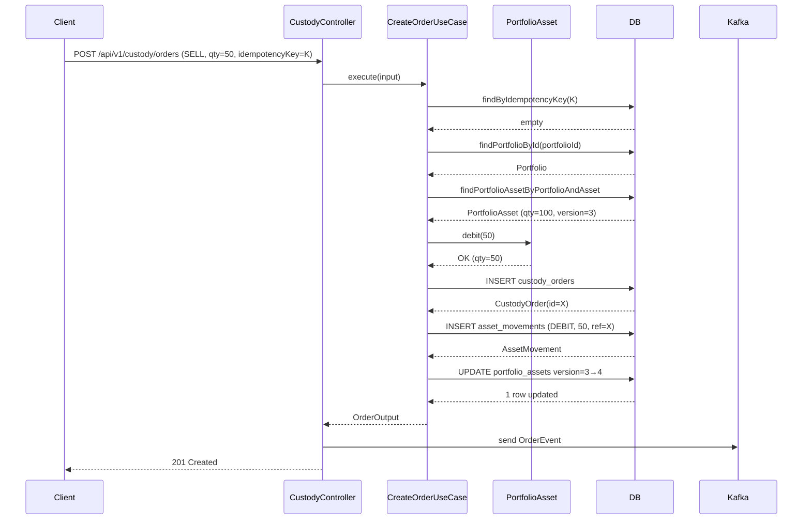
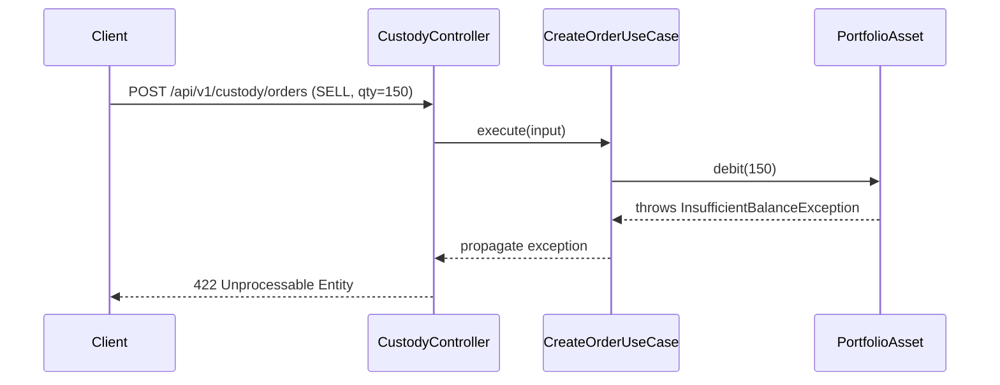
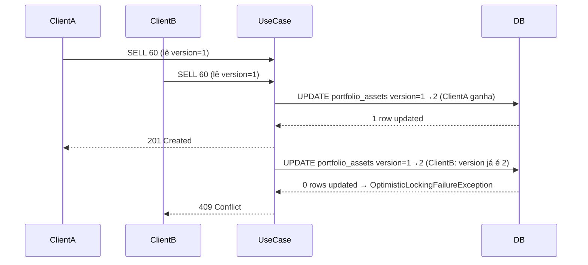
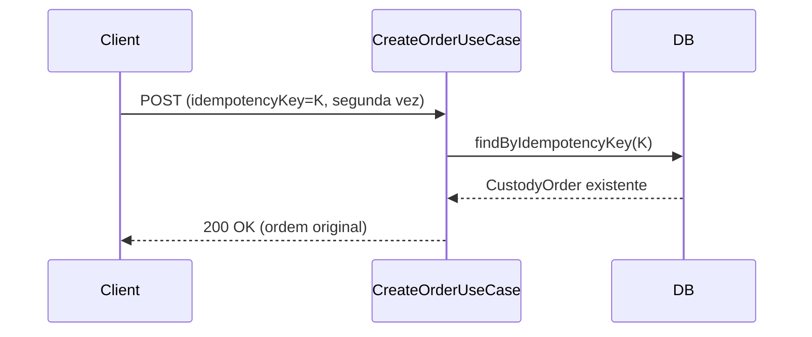

# Design — Integridade Financeira e Transações

## Contexto

Ver `proposal.md — Por que`. O `custody-service` já usa `@Transactional` e `BigDecimal`, mas não tem bloqueio de saldo, controle de concorrência, idempotência ou registro imutável de movimentações. Esta change fecha todas essas lacunas sem alterar a interface Kafka nem outros serviços.

## Metas / Não-Metas

**Metas:**
- Bloquear SELL com saldo insuficiente antes de persistir qualquer dado (validação no domínio).
- Garantir detecção de conflito concorrente via `@Version` (optimistic locking) em `PortfolioAssetEntity`.
- Fazer `CreateOrderUseCase` idempotente via `idempotencyKey` com constraint `UNIQUE` no banco.
- Registrar toda mutação de posição em `asset_movements` como entrada imutável no mesmo `@Transactional`.
- Manter todos os campos de quantidade como `BigDecimal` — sem `double`, `float` ou primitivos numéricos.

**Não-Metas:**
- Cash balance / saldo de caixa.
- Endpoint de consulta do histórico de movimentações (change futura).
- Flyway/Liquibase — schema gerenciado por `ddl-auto: update`.
- Modificações em outros microsserviços.

---

## Decisões de Design

### D-1 — Concorrência: Lock Otimista (`@Version`)

**Escolhido:** `@Version Long version` em `PortfolioAssetEntity`.

**Justificativa:** Lock otimista não mantém conexão de banco aberta enquanto espera — é adequado para o volume esperado de ordens, e o conflito (raro) é retornado como `ObjectOptimisticLockingFailureException`, mapeado para HTTP 409 no `GlobalExceptionHandler`. O cliente pode retentar com segurança.

**Alternativa rejeitada:** `@Lock(PESSIMISTIC_WRITE)` — serializa escritas no banco, aumenta contenção e latência; reservado para cenários de alta frequência sobre o mesmo ativo, que não é o caso deste MVP.

### D-2 — Idempotência: `idempotencyKey` UUID com UNIQUE constraint

**Escolhido:** Campo `idempotencyKey UUID` em `CustodyOrderEntity` com `@Column(unique = true, nullable = true)`. O cliente pode passar o valor; se omitido, o servidor gera um `UUID.randomUUID()`. Quando uma `DataIntegrityViolationException` (unique constraint) é detectada ao salvar, o use case consulta a ordem existente via `findByIdempotencyKey` e retorna `200 OK`.

**Semântica de retorno:** `201 Created` na primeira criação; `200 OK` em replay com mesmo `idempotencyKey`.

**Alternativa rejeitada:** Verificar `findByIdempotencyKey` antes do `save` — gera race condition entre check e insert em acesso paralelo. A abordagem "tenta salvar → captura violação de constraint" é segura e idiomática.

### D-3 — Validação de saldo: no domínio, antes do lock

**Escolhido:** `PortfolioAsset.debit(BigDecimal quantity)` valida `this.quantity.compareTo(quantity) >= 0` antes de decrementar. Lança `InsufficientBalanceException` (nova). O use case chama `debit()` na entidade de domínio depois de carregar a posição, mas antes de persistir. O `@Version` detecta se outra transação modificou a posição entre a leitura e o save.

**Fluxo completo (SELL):**
```
1. [DB] SELECT portfolio_assets WHERE portfolio_id=X AND asset_id=Y → posição (com version N)
2. [Domain] portfolioAsset.debit(qty)  → lança InsufficientBalanceException se qty > saldo
3. [DB] INSERT custody_orders (idempotencyKey, ...)
4. [DB] INSERT asset_movements (DEBIT, qty, referenceOrderId, ...)
5. [DB] UPDATE portfolio_assets SET quantity=q-qty, version=N+1 WHERE id=Z AND version=N
         → se version mudou entre 1 e 5: Hibernate lança ObjectOptimisticLockingFailureException
6. [Kafka] kafkaTemplate.send(...)  ← fora da transação JPA (após commit)
```

**Fluxo completo (BUY):**
```
1. Não há verificação de saldo — BUY cria a posição se não existir ou soma a existente
2. [DB] INSERT custody_orders
3. [DB] INSERT asset_movements (CREDIT, qty, referenceOrderId)
4. [DB] UPSERT portfolio_assets (cria com qty ou soma qty ao existente, incrementa version)
5. [Kafka] kafkaTemplate.send(...)
```

### D-4 — `AssetMovement`: imutabilidade via ausência de setters

**Escolhido:** A classe de domínio `AssetMovement` terá apenas um construtor com todos os campos e nenhum setter público. A entidade JPA `AssetMovementEntity` espelha esse contrato: `@Column(updatable = false)` em todos os campos de dados; `@PrePersist` para `occurredAt`. Nenhum método de update ou delete é exposto no repositório.

### D-5 — Posição BUY: upsert de `PortfolioAsset`

Para BUY, o portfólio pode não ter a posição ainda (primeira compra do ativo). O repositório precisará de um método `findByPortfolioIdAndAssetId` — se ausente, cria nova `PortfolioAsset` com `quantity = 0` antes de somar. Todo esse fluxo fica dentro do `@Transactional` de `CreateOrderUseCase`.

---

## Diagrama de Sequência

### Fluxo SELL bem-sucedido



### Fluxo SELL com saldo insuficiente



### Fluxo com conflito de concorrência (otimista)



### Fluxo idempotente (replay)



---

## Contrato HTTP

### `POST /api/v1/custody/orders` — atualizado

**Request Body:**

```json
{
  "portfolioId": "uuid",
  "assetId": "uuid",
  "type": "BUY | SELL",
  "quantity": "decimal (BigDecimal, > 0)",
  "idempotencyKey": "uuid (opcional — gerado pelo servidor se ausente)"
}
```

**Respostas:**

| Status | Condição |
|--------|----------|
| `201 Created` | Ordem criada com sucesso (primeira vez) |
| `200 OK` | `idempotencyKey` já existe — ordem original retornada |
| `400 Bad Request` | `quantity <= 0`, `portfolioId` ou `assetId` ausentes |
| `404 Not Found` | Portfolio ou Asset não encontrado |
| `409 Conflict` | Conflito de versão otimista — cliente deve retentar |
| `422 Unprocessable Entity` | Saldo insuficiente para SELL |

**Response Body (`201` / `200`):**

```json
{
  "id": "uuid",
  "portfolioId": "uuid",
  "assetId": "uuid",
  "type": "BUY | SELL",
  "quantity": "decimal",
  "status": "PENDING",
  "idempotencyKey": "uuid",
  "createdAt": "datetime"
}
```

**Response Body de erro (422):**

```json
{
  "error": "Saldo insuficiente: portfólio possui X unidades, solicitado Y",
  "timestamp": "datetime"
}
```

**Response Body de erro (409):**

```json
{
  "error": "Conflito de concorrência: a posição foi modificada por outra operação. Tente novamente.",
  "timestamp": "datetime"
}
```

---

## Modelo de Dados

### Tabela `asset_movements` (nova)

| Coluna | Tipo | Constraints |
|---|---|---|
| `id` | UUID | PK, gerado automaticamente |
| `portfolio_id` | UUID | NOT NULL, FK → portfolios |
| `asset_id` | UUID | NOT NULL, FK → assets |
| `type` | VARCHAR | NOT NULL (`DEBIT` / `CREDIT`) |
| `quantity` | NUMERIC | NOT NULL |
| `reference_order_id` | UUID | NOT NULL, FK → custody_orders |
| `occurred_at` | TIMESTAMP | NOT NULL, imutável (`@PrePersist`, `updatable=false`) |

Índice recomendado: `(portfolio_id, asset_id, occurred_at DESC)` — para futuras consultas de histórico.

### Alterações em tabelas existentes

| Tabela | Coluna | Ação | Motivo |
|---|---|---|---|
| `portfolio_assets` | `version` BIGINT DEFAULT 0 | ADICIONAR | Lock otimista Hibernate `@Version` |
| `custody_orders` | `idempotency_key` UUID UNIQUE NULL | ADICIONAR | Dedup de requisições |

---

## Arquitetura de Classes

```
domain/
  enums/
    MovementType.java          (DEBIT, CREDIT)
  exceptions/
    InsufficientBalanceException.java
  models/
    AssetMovement.java         (imutável — construtor all-args, sem setters)
    PortfolioAsset.java        (+ método debit(BigDecimal))
    CustodyOrder.java          (+ campo idempotencyKey)
  repositories/
    AssetMovementRepository.java   (save, findByPortfolioIdAndAssetId)

application/
  dto/
    CreateOrderInput.java      (+ idempotencyKey)
    OrderOutput.java           (+ idempotencyKey)
  usecases/
    CreateOrderUseCase.java    (+ idempotência, validação de saldo, movimentação)

infrastructure/
  persistence/
    entities/
      AssetMovementEntity.java      (@Entity, todos campos updatable=false)
      PortfolioAssetEntity.java     (+ @Version Long version)
      CustodyOrderEntity.java       (+ UUID idempotencyKey, @Column unique=true)
    repositories/
      SpringDataAssetMovementRepository.java
      SpringDataPortfolioAssetRepository.java  (+ findByPortfolioIdAndAssetId)
    adapters/
      AssetMovementRepositoryImpl.java
    mappers/
      AssetMovementMapper.java

presentation/
  request/
    CustodyOrderRequest.java   (+ idempotencyKey)
  response/
    CustodyOrderResponse.java  (+ idempotencyKey)
  controllers/
    GlobalExceptionHandler.java  (+ InsufficientBalanceException → 422,
                                    OptimisticLockingFailureException → 409)
```

---

## Rastreabilidade Requisito → Cenário → Teste

| Requisito | Cenário (spec.md) | Classe de Teste |
|---|---|---|
| Bloqueio de saldo insuficiente (SELL) | `Feature: Bloqueio de saldo insuficiente` Sc. 1–4 | `CreateOrderUseCaseTest`, `CustodyControllerTest` |
| BUY não bloqueado | `Feature: Bloqueio` Sc. 5 | `CreateOrderUseCaseTest` |
| Idempotência — primeiro create | `Feature: Idempotência` Sc. 1 | `CreateOrderUseCaseTest` |
| Idempotência — replay 200 OK | `Feature: Idempotência` Sc. 2 | `CreateOrderUseCaseTest`, `CreateOrderUseCaseIntegrationTest` |
| Idempotência — chaves distintas | `Feature: Idempotência` Sc. 3 | `CreateOrderUseCaseIntegrationTest` |
| Idempotência — chave auto-gerada | `Feature: Idempotência` Sc. 4 | `CreateOrderUseCaseTest` |
| Conflito otimista → 409 | `Feature: Concorrência` Sc. 1–2 | `CreateOrderUseCaseIntegrationTest` |
| Movimentação CREDIT em BUY | `Feature: Histórico imutável` Sc. 1 | `CreateOrderUseCaseTest`, `AssetMovementIntegrationTest` |
| Movimentação DEBIT em SELL | `Feature: Histórico imutável` Sc. 2 | `CreateOrderUseCaseTest` |
| Imutabilidade de AssetMovement | `Feature: Histórico imutável` Sc. 3 | `AssetMovementTest` (unitário domínio) |
| Precisão BigDecimal 5 casas | `Feature: Precisão monetária` Sc. 1–2 | `AssetMovementIntegrationTest` |
| Atomicidade — rollback parcial | `Feature: Atomicidade` Sc. 1–2 | `CreateOrderUseCaseIntegrationTest` |
| Atomicidade — commit completo | `Feature: Atomicidade` Sc. 3 | `CreateOrderUseCaseIntegrationTest` |

---

## Questões em Aberto

- **Q-1:** O `event-processor` consome `OrderEvent` e pode também atualizar `portfolio_assets`. Ele continuará fazendo isso depois desta change? Se sim, pode sobrescrever a posição já debitada pelo `custody-service`. É necessário alinhar os dois serviços antes do deploy.
- **Q-2:** Existe algum mecanismo de retry no cliente (Insomnia, app mobile)? Se sim, `idempotencyKey` deve ser documentado como obrigatório recomendado.
- **Q-3:** `portfolio_assets` não tem tabela Spring Data Repository dedicada ainda — existe apenas via `PortfolioRepositoryImpl` através da relação `cascade = ALL`. Precisará de um `SpringDataPortfolioAssetRepository` independente para suportar `findByPortfolioIdAndAssetId` com lock e o `@Version` no update.
