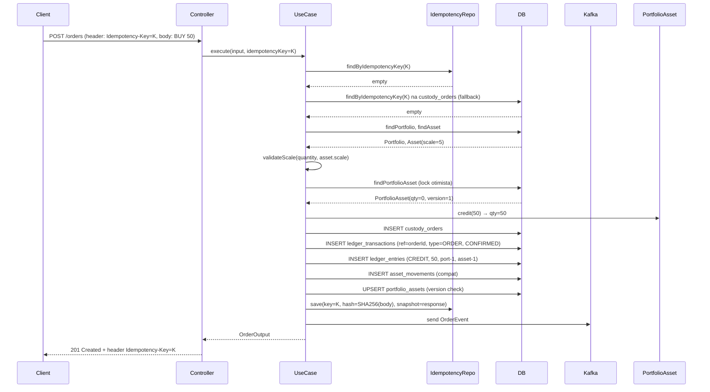
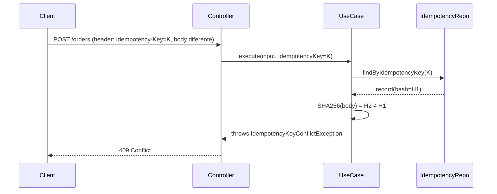
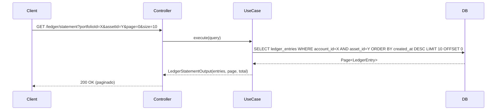

# Design — Ledger Financeiro

## Contexto

A change anterior (`integridade-financeira-transferencias`) implementou `AssetMovement` como registro único por operação. Esta change evolui para um ledger contábil estruturado: `LedgerTransaction` agrupa `LedgerEntry`(s), permitindo partidas dobradas, idempotência via HTTP header com hash, escala configurável por ativo e consulta de extrato paginada.

## Metas / Não-Metas

**Metas:**
- Criar `LedgerTransaction` e `LedgerEntry` como estruturas imutáveis agrupando lançamentos por operação.
- Substituir `idempotencyKey` no body por `Idempotency-Key` HTTP header com hash SHA-256 dos parâmetros.
- Adicionar campo `scale` em `Asset` para validação de precisão por ativo.
- Implementar endpoint de extrato paginado (`GET /api/v1/custody/ledger/statement`).
- Avaliar `PESSIMISTIC_WRITE` para transferências; documentar quando usar cada estratégia de lock.

**Não-Metas:**
- Endpoint de transferência entre portfólios (change futura — esta change prepara a estrutura).
- Migrar dados históricos de `asset_movements` para `ledger_entries`.
- Introduzir conta de custódia como contrapartida para partidas dobradas em BUY/SELL simples.
- Deploy, infraestrutura, Terraform.
- Modificações em outros microsserviços.

---

## Decisões de Design

### D-1 — LedgerEntry coexiste com AssetMovement

**Escolhido:** `CreateOrderUseCase` grava em ambos `AssetMovement` (existente) e `LedgerTransaction` + `LedgerEntry` (novo) na mesma transação. `AssetMovement` é deprecariado em change futura.

**Justificativa:** Evita breaking change no código existente e nos testes já validados. Permite rollback seguro se o ledger tiver problemas.

**Alternativa rejeitada:** Substituir `AssetMovement` imediatamente — risco de perda de rastreabilidade durante a transição.

### D-2 — Partidas dobradas apenas para TRANSFER

**Escolhido:** BUY gera 1 CREDIT, SELL gera 1 DEBIT (entrada única, sem contrapartida). TRANSFER gera 2 entradas (DEBIT origem + CREDIT destino) com balanceamento validado por ativo.

**Justificativa:** O sistema custodia ativos, não dinheiro. Não há "conta de caixa" como contrapartida natural. Introduzir uma conta de custódia fictícia adiciona complexidade sem valor de negócio no MVP.

**Alternativa rejeitada:** Introduzir conta de custódia do sistema como contrapartida de todo BUY/SELL — complexidade desnecessária para o modelo atual.

### D-3 — IdempotencyRecord em tabela separada

**Escolhido:** Nova tabela `idempotency_records` com `idempotencyKey` (UUID UNIQUE), `requestHash` (SHA-256 do body), `responseSnapshot` (JSONB), `createdAt`. O `idempotencyKey` deixa de ser campo na `custody_orders` e passa a ser gerenciado exclusivamente nesta tabela.

**Fluxo:**
```
1. Controller extrai header Idempotency-Key (ou gera UUID)
2. Use case verifica findByIdempotencyKey(key)
   - Se existe e hash coincide → retorna responseSnapshot (200)
   - Se existe e hash difere → lança IdempotencyKeyConflictException (409)
3. Se não existe → executa operação, armazena responseSnapshot + hash
4. Unique constraint protege contra concorrência
```

**Justificativa:** Permite reusar idempotência para qualquer endpoint futuro, não apenas orders. O `responseSnapshot` garante que o replay retorna exatamente a mesma resposta.

### D-4 — Scale por ativo com validação no domínio

**Escolhido:** Campo `scale` (Integer, default 5) em `Asset` e `AssetEntity`. O use case valida `quantity.scale() <= asset.getScale()` antes de processar. Se a escala exceder, lança `InvalidQuantityException` (422). `RoundingMode.HALF_EVEN` para operações que precisam arredondar.

### D-5 — Lock estratégia: @Version para portfólio, PESSIMISTIC_WRITE para transferência

**Escolhido:**
- **@Version (otimista)**: mantém para operações de portfólio individual (BUY/SELL). Já implementado e testado.
- **PESSIMISTIC_WRITE**: para transferências entre portfólios (change futura), onde duas posições são modificadas na mesma transação. O lock pessimista evita deadlock circular e garante serialização.

**Tratamento de erro:**
- `ObjectOptimisticLockingFailureException` → 409 (já implementado)
- `PessimisticLockingFailureException` / `CannotAcquireLockException` → 409 com mensagem "Conflito de concorrência, tente novamente"

**Política de isolamento:** `READ_COMMITTED` (default PostgreSQL) — adequada para o volume esperado.

---

## Diagrama de Sequência

### Fluxo BUY com ledger e idempotência



### Fluxo de rejeição de reuso de chave



### Fluxo de extrato paginado



---

## Contrato HTTP

### `POST /api/v1/custody/orders` — atualizado

**Headers:**
```
Idempotency-Key: uuid (opcional — gerado pelo servidor se ausente)
Content-Type: application/json
```

**Request Body (sem `idempotencyKey` — movido para header):**
```json
{
  "portfolioId": "uuid",
  "assetId": "uuid",
  "type": "BUY | SELL",
  "quantity": "decimal (BigDecimal, > 0, scale <= asset.scale)"
}
```

**Respostas:**

| Status | Condição |
|--------|----------|
| `201 Created` | Ordem criada (primeira vez) |
| `200 OK` | Idempotency-Key replay — retorna responseSnapshot |
| `400 Bad Request` | quantity <= 0, NaN, Infinity, campos ausentes |
| `404 Not Found` | Portfolio ou Asset não encontrado |
| `409 Conflict` | Conflito de versão (otimista/pessimista) ou reuso de Idempotency-Key com body diferente |
| `422 Unprocessable Entity` | Saldo insuficiente (SELL) ou escala do quantity excede asset.scale |

**Response Headers:**
```
Idempotency-Key: uuid (sempre presente na resposta)
```

### `GET /api/v1/custody/ledger/statement` — novo

**Query Params:**

| Param | Tipo | Obrigatório | Default |
|-------|------|------------|---------|
| `portfolioId` | UUID | sim | — |
| `assetId` | UUID | não | null (todos os ativos) |
| `page` | int | não | 0 |
| `size` | int | não | 20 (máx 100) |

**Response Body (200):**
```json
{
  "entries": [
    {
      "id": "uuid",
      "transactionId": "uuid",
      "transactionType": "ORDER",
      "accountId": "uuid",
      "assetId": "uuid",
      "entryType": "CREDIT",
      "quantity": "decimal",
      "createdAt": "datetime"
    }
  ],
  "page": 0,
  "size": 20,
  "totalElements": 15,
  "totalPages": 1
}
```

---

## Modelo de Dados

### Tabela `ledger_transactions` (nova)

| Coluna | Tipo | Constraints |
|---|---|---|
| `id` | UUID | PK |
| `reference` | UUID | NOT NULL, UNIQUE |
| `transaction_type` | VARCHAR | NOT NULL (`ORDER`, `TRANSFER`, `ADJUSTMENT`) |
| `status` | VARCHAR | NOT NULL (`PENDING`, `CONFIRMED`, `REJECTED`) |
| `created_at` | TIMESTAMP | NOT NULL, `updatable=false`, `@PrePersist` |

Índice: `(reference)` UNIQUE (próprio da constraint).

### Tabela `ledger_entries` (nova)

| Coluna | Tipo | Constraints |
|---|---|---|
| `id` | UUID | PK |
| `transaction_id` | UUID | NOT NULL, FK → ledger_transactions |
| `account_id` | UUID | NOT NULL |
| `asset_id` | UUID | NOT NULL |
| `entry_type` | VARCHAR | NOT NULL (`DEBIT`, `CREDIT`) |
| `quantity` | NUMERIC(38,5) | NOT NULL, `updatable=false` |
| `created_at` | TIMESTAMP | NOT NULL, `updatable=false`, `@PrePersist` |

Índices: `(account_id, asset_id, created_at DESC)`, `(transaction_id)`.

### Tabela `idempotency_records` (nova)

| Coluna | Tipo | Constraints |
|---|---|---|
| `id` | UUID | PK |
| `idempotency_key` | UUID | NOT NULL, UNIQUE |
| `request_hash` | VARCHAR(64) | NOT NULL (SHA-256 hex) |
| `response_snapshot` | JSONB | NOT NULL |
| `created_at` | TIMESTAMP | NOT NULL, `updatable=false`, `@PrePersist` |

### Alterações em tabelas existentes

| Tabela | Coluna | Ação | Motivo |
|---|---|---|---|
| `assets` | `scale` INT DEFAULT 5 | ADICIONAR | Escala decimal por ativo |
| `custody_orders` | `idempotency_key` | MANTER (deprecated) | Compatibilidade — idempotência migra para `idempotency_records` |

---

## Arquitetura de Classes

```
domain/
  enums/
    TransactionType.java       (ORDER, TRANSFER, ADJUSTMENT)
    TransactionStatus.java     (PENDING, CONFIRMED, REJECTED)
    EntryType.java             (DEBIT, CREDIT)
  exceptions/
    IdempotencyKeyConflictException.java
    InvalidScaleException.java
  models/
    LedgerTransaction.java     (imutável — construtor all-args, sem setters)
    LedgerEntry.java           (imutável — construtor all-args, sem setters)
    IdempotencyRecord.java     (imutável — construtor all-args, sem setters)
    Asset.java                 (+ campo Integer scale)
  repositories/
    LedgerTransactionRepository.java  (save, findByReference)
    LedgerEntryRepository.java        (save, findByAccountIdAndAssetId paginado)
    IdempotencyRecordRepository.java  (save, findByIdempotencyKey)

application/
  dto/
    LedgerStatementOutput.java
    LedgerEntryOutput.java
  usecases/
    CreateOrderUseCase.java          (MODIFICAR — ledger + idempotency record)
    GetLedgerStatementUseCase.java    (CRIAR — extrato paginado)

infrastructure/
  persistence/
    entities/
      LedgerTransactionEntity.java   (@Entity, updatable=false em tudo)
      LedgerEntryEntity.java         (@Entity, updatable=false em tudo)
      IdempotencyRecordEntity.java    (@Entity, updatable=false em tudo)
      AssetEntity.java               (+ @Column scale)
    repositories/
      SpringDataLedgerTransactionRepository.java
      SpringDataLedgerEntryRepository.java
      SpringDataIdempotencyRecordRepository.java
    adapters/
      LedgerTransactionRepositoryImpl.java
      LedgerEntryRepositoryImpl.java
      IdempotencyRecordRepositoryImpl.java
    mappers/
      LedgerTransactionMapper.java
      LedgerEntryMapper.java
      IdempotencyRecordMapper.java

presentation/
  controllers/
    CustodyController.java     (MODIFICAR — extrair Idempotency-Key header)
    GlobalExceptionHandler.java (MODIFICAR — IdempotencyKeyConflictException → 409)
  response/
    LedgerStatementResponse.java
    LedgerEntryResponse.java
```

---

## Rastreabilidade Requisito → Cenário → Teste

| Requisito | Cenário (spec.md) | Classe de Teste |
|---|---|---|
| LedgerTransaction + LedgerEntry em BUY | `Feature: Ledger contábil` Sc. 1 | `CreateOrderUseCaseTest`, `LedgerIntegrationTest` |
| LedgerEntry DEBIT em SELL | `Feature: Ledger contábil` Sc. 2 | `CreateOrderUseCaseTest` |
| Referência única por movimentação | `Feature: Ledger contábil` Sc. 3 | `LedgerIntegrationTest` |
| Imutabilidade de LedgerEntry | `Feature: Ledger contábil` Sc. 4 | `LedgerEntryTest` (unitário) |
| Reconstrução de posição | `Feature: Ledger contábil` Sc. 5 | `LedgerIntegrationTest` |
| Extrato paginado | `Feature: Ledger contábil` Sc. 6 | `GetLedgerStatementUseCaseTest`, `LedgerIntegrationTest` |
| Partidas dobradas em transferência | `Feature: Balanceamento` Sc. 1 | `LedgerIntegrationTest` |
| Transferência parcial rejeitada | `Feature: Balanceamento` Sc. 2 | `LedgerIntegrationTest` |
| Escala por ativo aceita | `Feature: Precisão` Sc. 1 | `CreateOrderUseCaseTest` |
| Escala 0 rejeita decimal | `Feature: Precisão` Sc. 2 | `CreateOrderUseCaseTest` |
| NaN/Infinity rejeitado | `Feature: Precisão` Sc. 3 | `CustodyControllerTest` |
| RoundingMode HalfEven | `Feature: Precisão` Sc. 4 | `LedgerIntegrationTest` |
| BigDecimal em todos os campos | `Feature: Precisão` Sc. 5 | `LedgerEntryTest` |
| Idempotency-Key header cria | `Feature: Idempotência` Sc. 1 | `CreateOrderUseCaseTest` |
| Replay retorna original | `Feature: Idempotência` Sc. 2 | `CreateOrderUseCaseTest`, `IdempotencyIntegrationTest` |
| Reuso com body diferente rejeitado | `Feature: Idempotência` Sc. 3 | `IdempotencyIntegrationTest` |
| Chave auto-gerada | `Feature: Idempotência` Sc. 4 | `CreateOrderUseCaseTest` |
| 10 simultâneas = 1 operação | `Feature: Idempotência` Sc. 5 | `IdempotencyIntegrationTest` |
| Concorrência pessimista | `Feature: Concorrência` Sc. 1 | `LedgerIntegrationTest` |
| Deadlock tratado | `Feature: Concorrência` Sc. 2 | `LedgerIntegrationTest` |
| Extrato paginado | `Feature: Extrato` Sc. 1 | `GetLedgerStatementUseCaseTest` |
| Extrato vazio | `Feature: Extrato` Sc. 2 | `GetLedgerStatementUseCaseTest` |
| Extrato sem assetId | `Feature: Extrato` Sc. 3 | `GetLedgerStatementUseCaseTest` |

---

## Questões em Aberto

- **Q-1:** Introduzir "conta de custódia" como contrapartida para partidas dobradas em BUY/SELL? Recomendação: não no MVP; avaliar quando houver requisitos regulatórios.
- **Q-2:** `responseSnapshot` em JSONB no PostgreSQL — precisa de `@Type(type = "jsonb")` do Hypersistence Utils ou converter para String? Recomendação: usar `@Column(columnDefinition = "jsonb")` com converter customizado `AttributeConverter<String, String>`.
- **Q-3:** O `event-processor` também atualiza `portfolio_assets` — precisa alinhar com o ledger? Resposta: o `event-processor` processa ordens Kafka e pode chamar o mesmo fluxo de ledger. Avaliar em change futura.
- **Q-4:** TTL ou cleanup de `idempotency_records`? Recomendação: manter indefinidamente (auditabilidade). Se necessário, policy de limpeza após 90 dias.
