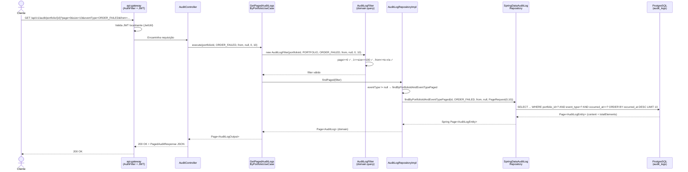
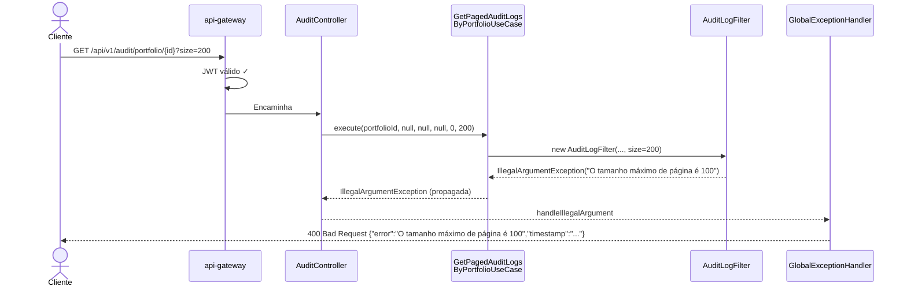
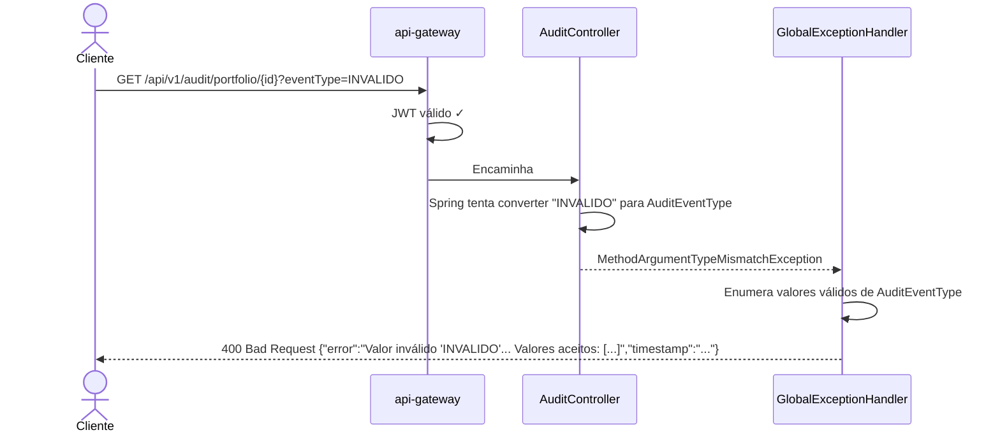
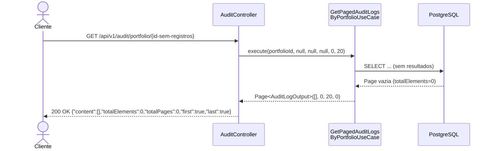
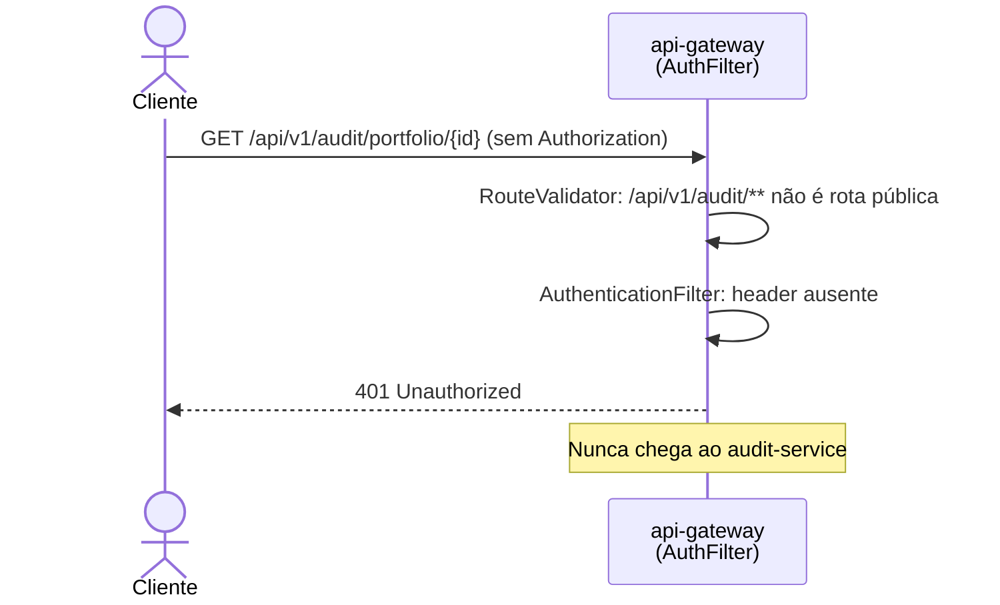

# Design

## Context

Ver `proposal.md — Why` para a motivação. O `audit-service` (porta 8084) segue Clean Architecture com quatro camadas: `domain → application → infrastructure → presentation`. A tabela `audit_logs` no PostgreSQL 16 já tem índices simples em `order_id` e `portfolio_id`. O Hibernate é configurado com `ddl-auto: update` — índices são gerenciados via anotações JPA, não por scripts de migration.

O banco usa `LocalDateTime` para `occurredAt`; não há timezone explícito na camada de persistência.

A autenticação JWT é responsabilidade exclusiva do `api-gateway` (`AuthenticationFilter` + `JwtUtil`). O `audit-service` confia no gateway e não valida JWT diretamente.

## Goals / Non-Goals

**Goals:**
- Paginação server-side com validação de limites no domínio
- Filtros opcionais por `eventType`, `from` e `to` sem degradação em casos sem filtro
- `Page<T>` de domínio sem dependência de Spring Data
- Índices compostos alinhados com as queries reais
- Tratamento de erros sem vazamento de informação interna

**Non-Goals:**
- Ordenação dinâmica por campo arbitrário via query param
- Cache de resultados
- Paginação por cursor/keyset
- Isolamento de dados por usuário (sistema não tem autorização por usuário)
- Suporte a timezone explícito (registrado como P-5)
- Alterações em outros microsserviços

## Decisions

### D-1 — AuditLogFilter em `domain.query`, não em `application.dto`

A interface `AuditLogRepository` (domínio) precisa referenciar o critério de busca. Se o filtro ficasse em `application.dto`, o domínio dependeria da camada de aplicação — inversão da hierarquia da Clean Architecture. Critério de busca com regras de validação (limites de paginação, coerência de datas) pertence ao domínio.

**Alternativa rejeitada:** definir uma interface `AuditQuery` no domínio e fazer o DTO de application implementá-la. Adiciona indireção sem benefício aqui.

### D-2 — Quatro queries JPQL especializadas em vez de query única com `IS NULL OR`

O Hibernate 6 (Spring Boot 3.4) apresenta comportamento não confiável com `AND (:eventType IS NULL OR e.eventType = :eventType)` quando `:eventType` é `null`: o binding sem tipo explícito para enum pode lançar `IllegalArgumentException` dependendo do dialeto. A solução adotada — quatro métodos `@Query` separados (com/sem `eventType`, por portfólio/por ordem) — garante que o binding sempre tem tipo definido e é consistente com a abordagem existente no projeto (ver `SpringDataProcessedOrderRepository`).

**Alternativas rejeitadas:** Criteria API (nova abstração não usada no projeto), SpEL em `@Query` (não suportado no Spring Data JPA para condicionais), JPA Specifications (mesmo problema de nova abstração).

O filtro temporal (`from` e `to`) com `LocalDateTime` é seguro — o Hibernate 6 não tem o mesmo problema de inferência de tipo com `LocalDateTime` nullable.

### D-3 — `Page<T>` como record do domínio

Evita que as camadas de domínio e aplicação conheçam `org.springframework.data.domain.Page`. O adapter em `AuditLogRepositoryImpl` faz a conversão entre o `Page` do Spring Data e o `Page` do domínio. Consistente com o isolamento de framework praticado no restante do projeto.

### D-4 — Handler 500 sem `ex.getMessage()`

Mensagens de exceção do Hibernate, SQL e Spring podem conter nomes de tabelas, colunas e detalhes de schema. Não devem ser expostos no response body em produção. O handler genérico retorna apenas `{ "error": "Erro interno do servidor", "timestamp": "..." }`. Logs server-side preservam o detalhe.

### D-5 — Mesmo path `/v1`, sem versionamento de endpoint

Os endpoints substituem os originais no mesmo path e versão. Essa é uma breaking change documentada e assumida, com a premissa de que todos os consumidores conhecidos são internos (api-gateway, testes). Ver P-2 nas Pendências.

### D-6 — Índices compostos `(portfolio_id, occurred_at DESC)` e `(order_id, occurred_at DESC)`

O `ORDER BY occurredAt DESC` das queries se beneficia de um índice que cobre tanto o filtro de igualdade (`portfolio_id = :id`) quanto a ordenação. O PostgreSQL pode usar o índice composto para servir os resultados já ordenados, eliminando um sort explícito. O `event_type` não entra no índice por não ter cardinalidade suficiente para justificar um terceiro índice neste momento — avaliação futura com `EXPLAIN ANALYZE` em produção.

## Diagrama de Sequência

### Fluxo feliz — consulta por portfólio com filtros



### Fluxo de erro — parâmetro inválido (size > 100)



### Fluxo de erro — eventType inválido



### Fluxo de resultado vazio



### Fluxo — usuário não autenticado



## Contrato HTTP

### Endpoints

```
GET /api/v1/audit/portfolio/{portfolioId}
GET /api/v1/audit/order/{orderId}
Authorization: Bearer <token-jwt>
```

### Parâmetros de query

| Parâmetro | Tipo Java | Formato | Default | Validação |
|---|---|---|---|---|
| `page` | `int` | inteiro | `0` | `>= 0` → 400 se violado |
| `size` | `int` | inteiro | `20` | `1 ≤ size ≤ 100` → 400 se violado |
| `eventType` | `AuditEventType` | `ORDER_CREATED` / `ORDER_PROCESSED` / `ORDER_FAILED` | ausente | 400 se valor inválido (conversão Spring) |
| `from` | `LocalDateTime` | `yyyy-MM-ddTHH:mm:ss` | ausente | `from <= to` quando ambos presentes → 400 |
| `to` | `LocalDateTime` | `yyyy-MM-ddTHH:mm:ss` | ausente | idem |

### Resposta 200 OK

```json
{
  "content": [
    {
      "id":          "550e8400-e29b-41d4-a716-446655440000",
      "orderId":     "uuid",
      "portfolioId": "uuid",
      "assetId":     "uuid-ou-null",
      "eventType":   "ORDER_CREATED",
      "payload":     "{\"orderId\":\"...\"}",
      "occurredAt":  "2026-10-15T14:30:00"
    }
  ],
  "page":          0,
  "size":          20,
  "totalElements": 1,
  "totalPages":    1,
  "first":         true,
  "last":          true
}
```

### Resposta 400 Bad Request

```json
{ "error": "Mensagem descritiva", "timestamp": "2026-10-29T14:00:00.123" }
```

### Resposta 500 Internal Server Error

```json
{ "error": "Erro interno do servidor", "timestamp": "2026-10-29T14:00:00.123" }
```

## Arquivos a Criar ou Modificar

| Arquivo (relativo a `audit-service/src/main/java/...`) | Ação |
|---|---|
| `domain/models/Page.java` | CRIAR — record de paginação sem Spring Data |
| `domain/enums/FilterSubject.java` | CRIAR — enum `ORDER` / `PORTFOLIO` |
| `domain/query/AuditLogFilter.java` | CRIAR — critério de busca com validações |
| `domain/repositories/AuditLogRepository.java` | MODIFICAR — adicionar `Page<AuditLog> findPaged(AuditLogFilter)` |
| `application/usecases/GetPagedAuditLogsByPortfolioUseCase.java` | CRIAR |
| `application/usecases/GetPagedAuditLogsByOrderUseCase.java` | CRIAR |
| `presentation/response/PagedAuditResponse.java` | CRIAR — envelope HTTP de paginação |
| `presentation/controllers/AuditController.java` | MODIFICAR — novos query params, novo tipo de retorno |
| `presentation/controllers/GlobalExceptionHandler.java` | MODIFICAR — handler `MethodArgumentTypeMismatchException` + 500 seguro |
| `infrastructure/persistence/repositories/SpringDataAuditLogRepository.java` | MODIFICAR — 4 queries JPQL especializadas |
| `infrastructure/persistence/adapters/AuditLogRepositoryImpl.java` | MODIFICAR — implementar `findPaged()` |
| `infrastructure/persistence/entities/AuditLogEntity.java` | MODIFICAR — índices compostos |

**Arquivos de teste a criar:**

| Arquivo (relativo a `audit-service/src/test/java/...`) | Tipo |
|---|---|
| `domain/query/AuditLogFilterTest.java` | Unitário |
| `domain/models/PageTest.java` | Unitário |
| `application/usecases/GetPagedAuditLogsByPortfolioUseCaseTest.java` | Unitário |
| `application/usecases/GetPagedAuditLogsByOrderUseCaseTest.java` | Unitário |
| `presentation/AuditControllerTest.java` | MockMvc (`@WebMvcTest`) |
| `infrastructure/AuditLogRepositoryImplIntegrationTest.java` | Integração (Testcontainers) |

**Dependências de teste a adicionar em `audit-service/pom.xml`:**
```xml
<dependency>
    <groupId>org.testcontainers</groupId>
    <artifactId>junit-jupiter</artifactId>
    <version>1.19.7</version>
    <scope>test</scope>
</dependency>
<dependency>
    <groupId>org.testcontainers</groupId>
    <artifactId>postgresql</artifactId>
    <version>1.19.7</version>
    <scope>test</scope>
</dependency>
```

## Estratégia de Queries JPQL e Paginação

Quatro métodos `@Query` em `SpringDataAuditLogRepository`, todos com `ORDER BY e.occurredAt DESC` e `Pageable` como último parâmetro (o Spring Data gera a query de contagem automaticamente):

```java
// 1. Por portfólio, sem eventType
@Query("""
    SELECT e FROM AuditLogEntity e
    WHERE e.portfolioId = :portfolioId
      AND (:from IS NULL OR e.occurredAt >= :from)
      AND (:to   IS NULL OR e.occurredAt <= :to)
    ORDER BY e.occurredAt DESC
    """)
Page<AuditLogEntity> findByPortfolioIdPaged(
    @Param("portfolioId") UUID portfolioId,
    @Param("from") LocalDateTime from,
    @Param("to")   LocalDateTime to,
    Pageable pageable);

// 2. Por portfólio, com eventType (tipo explícito, sem IS NULL)
@Query("""
    SELECT e FROM AuditLogEntity e
    WHERE e.portfolioId = :portfolioId
      AND e.eventType   = :eventType
      AND (:from IS NULL OR e.occurredAt >= :from)
      AND (:to   IS NULL OR e.occurredAt <= :to)
    ORDER BY e.occurredAt DESC
    """)
Page<AuditLogEntity> findByPortfolioIdAndEventTypePaged(...);

// 3 e 4 — padrão espelhado por orderId
```

O `AuditLogRepositoryImpl.findPaged()` seleciona o método correto com base em `filter.getSubject()` e `filter.getEventType() != null`, converte o `Spring Page` para `domain.models.Page<AuditLog>`.

**Paginação por offset:** LIMIT/OFFSET via `Pageable`. Suficiente para o volume atual; paginação por cursor é avaliação futura para portfólios com histórico de longa data.

**Pendência P-1 — Desempate determinístico:** adicionar `, e.id ASC` ao ORDER BY de todas as queries quando P-1 for aprovado.

## Riscos / Trade-offs

- **Breaking change de contrato** → clientes legados quebram ao receber envelope em vez de array. Mitigação: inventariar consumidores antes do deploy (P-2).
- **Paginação por offset em alto volume** → páginas tardias degradam. Mitigação: limite de 100 atenua; índices compostos cobrem o caso principal; cursor é avaliação futura.
- **Ordenação não determinística** → dois registros com mesmo `occurredAt` podem trocar de posição entre páginas. Mitigação: P-1 (adicionar `id ASC` como desempate).
- **`ddl-auto: update` em produção** → risco pré-existente no projeto; fora do escopo desta change.
- **Sem testes de integração** → sem Testcontainers, o comportamento das queries JPQL com PostgreSQL não é verificado. Mitigação: tarefa dedicada na lista de tarefas.

## Migration Plan

1. Inventariar consumidores dos endpoints `v1` (P-2).
2. Combinar adição de Testcontainers ao `pom.xml` com criação dos testes de integração.
3. Compilar (`mvnw compile`) após cada conjunto de alterações relacionadas.
4. Executar testes unitários (`mvnw test -pl audit-service`).
5. Subir `docker-compose up -d` + `audit-service` localmente para smoke test manual.
6. Deploy após aprovação dos testes e confirmação de que os consumidores foram migrados.

**Rollback:** reverter os arquivos modificados no controller e no repositório. Os índices adicionados pelo Hibernate não causam rollback de dados.

## Open Questions

- **P-1** — Adicionar `id ASC` como critério de desempate? Impacta as 4 queries JPQL. Aguarda aprovação.
- **P-5** — Migrar `occurredAt` para `OffsetDateTime` para clareza de timezone? Impacta schema e mapeamento JPA. Avaliar em change separada.
